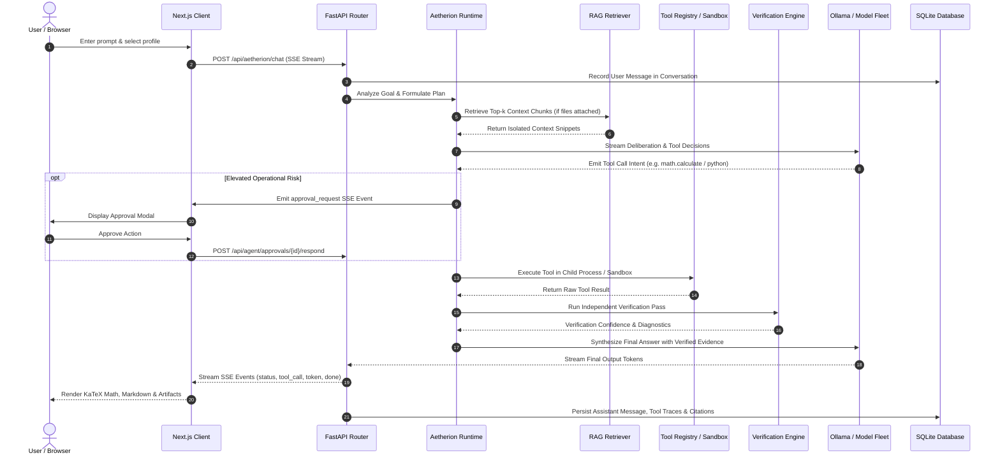

# System Architecture Documentation

**Platform:** Voltix Aetherion Agentic AI Platform  
**Version:** 2.0.0  
**Status:** Production  
**Target Environment:** Next.js 16.3.6 (App Router) | React 19.2.8 | FastAPI 0.115+ | SQLAlchemy 2.0 (Async) | SQLite / aiosqlite | Tailwind CSS v4

---

## 1. High-Level Architectural Vision

Voltix is an enterprise-grade agentic AI chatbot platform engineered for high-concurrency multi-model orchestration, adaptive task routing, retrieval-augmented intelligence, and sandboxed autonomous tool execution.

```
+───────────────────────────────────────────────────────────────────────────────────────────────+
|                                    VOLTIX APPLICATION SHELL                                   |
+─────────────────────────────────┬──────────────────────────────────┬──────────────────────────+
| COLLAPSIBLE SIDEBAR             | MAIN CHAT & STUDIO WORKSPACE     | INSPECTOR SLIDE-OVER     |
| - Session Controls & Pinned     | - Model Selector & Status Bar    | - Cited Sources Viewer   |
| - Global Search (Cmd+K)         | - Context Capacity Meter         | - Raw Document Chunks    |
| - Date-Grouped History Tree     | - Message Feed (Markdown+KaTeX)  | - Tool I/O Log Traces    |
| - Multi-Format Export           | - Composer with Slash Commands   | - Subagent Activity Feed |
+─────────────────────────────────┴──────────────────────────────────┴──────────────────────────+
                                                  │ HTTP REST / Server-Sent Events (SSE)
                                                  ▼
+───────────────────────────────────────────────────────────────────────────────────────────────+
|                                      FASTAPI BACKEND CORE                                     |
+──────────────────────────┬─────────────────────────────┬──────────────────────────────────────+
| AETHERION AGENT RUNTIME  | RAG & VECTOR ENGINE         | 17-TOOL SANDBOX ECOSYSTEM            |
| - Intent Router (Scores) | - Multi-Format Parsers      | - AST Math Evaluator (No eval)       |
| - Hierarchical Planner   | - Recursive Chunker         | - Multiprocessing Python Sandbox     |
| - Execution Profiles     | - Vector Store (index.json) | - Web, Filesystem & Code Tools       |
| - Verifier & HITL Policy | - Security XML Wrapper      | - Read-Only SQL & Artifact Engine    |
+──────────────────────────┴─────────────────────────────┴──────────────────────────────────────+
                                                  │ Async SQLAlchemy 2.0
                                                  ▼
+───────────────────────────────────────────────────────────────────────────────────────────────+
|                                PERSISTENCE & STORAGE (SQLite / FS)                            |
| - SQLite (app.db): Conversations, Messages, Files, AgentRuns, Steps, Checkpoints, Artifacts   |
| - File Storage: data/uploads, data/processed, data/vector_db, data/artifacts                  |
+───────────────────────────────────────────────────────────────────────────────────────────────+
                                                  │ Local HTTP / NDJSON
                                                  ▼
+───────────────────────────────────────────────────────────────────────────────────────────────+
|                                  ACTIVE MODEL INFERENCE FLEET                                 |
| - Ollama Local GGUF: qwen2.5:7b (Primary Worker), qwen2.5:3b (Low-Latency Utility)            |
| - Ollama Cloud Endpoints: nemotron-3-ultra:cloud, nemotron-3-super, gpt-oss:120b, gemma4:31b  |
| - Offline Fallback Engine: Zero-crash continuity assistant                                    |
+───────────────────────────────────────────────────────────────────────────────────────────────+
```

---

## 2. Core Subsystems

### 2.1 Frontend Client (Next.js 16 + React 19)
The client interface is structured around a 3-tier layout:
* **Navigation Sidebar**: Supports thread search, session pinning, inline renaming, branch navigation, and thread export (Markdown/JSON).
* **Main Chat & Studio Canvas**: Hosts real-time token streaming with live activity indicators, KaTeX math rendering, syntax-highlighted code blocks, and the Model Comparison Studio (`/studio`).
* **SlideOver Inspector**: A slide-over drawer enabling non-intrusive inspection of retrieved RAG snippets, document chunks, tool I/O execution details, and subagent deliberation traces.

### 2.2 Backend Orchestrator (FastAPI)
* **Lifespan Management**: Automatically initializes SQLite schemas, prepares file storage directories, and probes model daemon connectivity on startup.
* **Middleware & Security**: Includes strict CORS origin checks, request ID correlation tracking (`X-Request-ID`), structured logging, and RFC 7807 Problem Details error translation.
* **Asynchronous Execution**: Uses non-blocking `asyncio` pipelines for concurrent LLM token streaming, tool execution, and database persistence.

### 2.3 Aetherion Autonomous Agent Runtime
The agent system operates through a five-phase execution loop:
1. **Analyze & Route**: Evaluates prompt intent, file attachments, and complexity score to determine the optimal execution profile (`FAST`, `BALANCED`, `DEEP`, `MAX`).
2. **Plan**: Hierarchical task decomposition generating DAG step dependencies.
3. **Execute**: Dispatches subagents and invokes tools with timeout and resource constraints.
4. **Verify**: Independent verification passes validating calculations, citations, and created physical files.
5. **Synthesize**: Aggregates verified outputs into a structured final user response with linked artifacts.

### 2.4 Autonomous Tool Ecosystem
Voltix includes 17 specialized tools organized into distinct operational categories:
* **Computation**: Safe AST Mathematical Evaluator and isolated child-process Python Sandbox.
* **Research**: Live Web Search, Page Fetcher, and Recursive Deep Research.
* **Code & Filesystem**: Sandboxed File Read/Write/Delete, Code AST Search, Diff Generator, and Test Runner.
* **Persistence & Knowledge**: Read-only SQL Database Schema Inspector, Vector Search, Knowledge Graph query, and Persistent Memory Store.
* **Artifacts & Diagnostics**: Task Scheduler, Vision Inspector, and Artifact Synthesis.

### 2.5 RAG & Knowledge Retrieval
* **Multi-Format Ingestion**: Ingests PDF (pypdf), DOCX (python-docx), XLSX/CSV (openpyxl), PPTX (python-pptx), and source code/markdown.
* **Hierarchical Chunking**: Chunks text with recursive boundaries and token overlap.
* **Vector Indexing & Hybrid Search**: Computes sparse subword n-gram representations and dense embeddings stored in `data/vector_db/index.json`.
* **Prompt Injection Defense**: Encapsulates retrieved document chunks within strict untrusted XML boundary tags (`<document source="...">`) to prevent prompt-injection exploits.

### 2.6 Persistence Layer
* Managed via asynchronous SQLAlchemy 2.0 and `aiosqlite`.
* Schemas include `Conversation`, `Message`, `FileModel`, `AgentRun`, `AgentStep`, `AgentCheckpoint`, `ToolApproval`, `Artifact`, `TaskModel`, and `UserSettings`.

---

## 3. End-to-End Chat & Tool Execution Flow



---

## 4. Key Security Invariants

1. **Child-Process Isolation**: The Python execution tool runs in a separate child process with enforced CPU timeouts (15s), memory caps (256 MB), and blocked unsafe network built-ins.
2. **AST Mathematical Evaluation**: Mathematical expressions are strictly parsed via Python's Abstract Syntax Tree (`ast.parse`). No dynamic `eval()` or `exec()` is ever utilized for calculations.
3. **Path Traversal Prevention**: File paths are sanitized and strictly confined to the `data/` working directory.
4. **Human-in-the-Loop Confirmation**: Destructive tools (`filesystem.delete`, `terminal.run_safe` with write commands) require explicit user confirmation before execution.
5. **Zero-Crash Fallback**: If the Ollama model daemon is offline or starting, the internal fallback assistant maintains conversational continuity without crashing the backend service.
